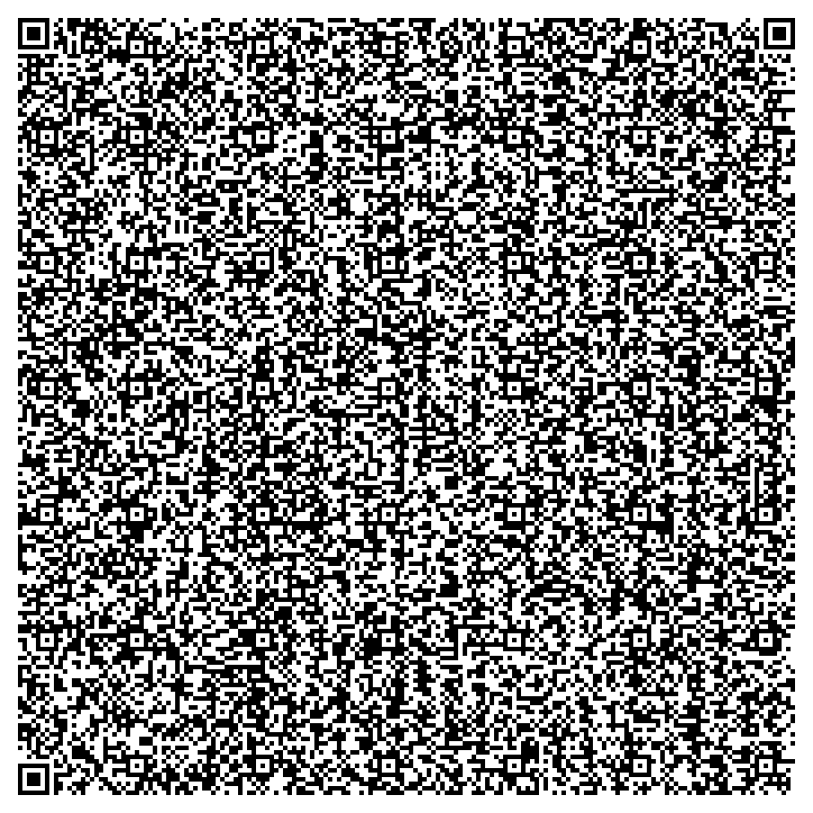

# CHIP-8 w kodzie QR

Prawdziwa emulacja w jednym kodzie QR: emulator CHIP-8 w JavaScripcie razem z grą napisaną od zera w kodzie maszynowym CHIP-8.



## Czym jest CHIP-8?
CHIP-8 to wirtualny komputer z lat 70., stworzony do pisania prostych gier na mikrokomputery (np. COSMAC VIP). Ma 4 KB pamięci, 16 rejestrów 8-bitowych, ekran 64×32 piksele, 16-klawiszową klawiaturę, dwa liczniki i 35 instrukcji. Programy na CHIP-8 mają zwykle 100–600 bajtów.

## Emulator
`gra.html` zawiera pełny emulator, czyli wszystkie 35 standardowych instrukcji:
- procesor wykonujący 720 instrukcji na sekundę,
- wbudowaną czcionkę cyfr 0–F,
- ekran 64×32 z rysowaniem XOR i wykrywaniem kolizji,
- liczniki opóźnienia i dźwięku (60 Hz) z sygnałem dźwiękowym,
- klawiaturę 4×4 na ekranie i mapowanie klawiatury komputera (`1234 / qwer / asdf / zxcv`, a strzałki ← → to klawisze 4 i 6).

Przyciskiem **Inny program** można wczytać dowolny plik `.ch8` z dysku i go uruchomić.

## Gra: Łapacz paczek
Paczki spadają z góry, a Ty łapiesz je koszem.
- **Sterowanie:** klawisze 4 i 6 (na komputerze strzałki ← → albo Q i E)
- Każda złapana paczka to punkt (lewy górny róg)
- Masz 3 życia (prawy górny róg), każda upuszczona paczka zabiera jedno
- Co 5 punktów paczki spadają szybciej
- Po przegranej dowolny klawisz zaczyna od nowa

Gra ma **213 bajtów** kodu maszynowego.

## Pliki
| Plik | Opis |
|---|---|
| `gra.html` | Emulator z wbudowanym programem gry (szesnastkowo) |
| `lapacz.asm` | Kod źródłowy gry w asemblerze CHIP-8, z komentarzami |
| `lapacz.ch8` | Skompilowany program (213 B), do wczytania w dowolnym emulatorze CHIP-8 |
| `qr.png` | Kod QR z linkiem do ładowarki |
| `link.txt` | Ten sam link jako tekst |

Asembler znajdziesz w `narzedzia/chip8_asm.py`:

```bash
python3 narzedzia/chip8_asm.py gry/chip8/lapacz.asm lapacz.ch8
```

Wypisuje rozmiar i kod szesnastkowy, który można wkleić do `gra.html` w miejsce obecnego programu.

## Rozmiar
- Emulator z grą: 3780 bajtów
- Link: 2784 znaki (QR w wersji 39)
