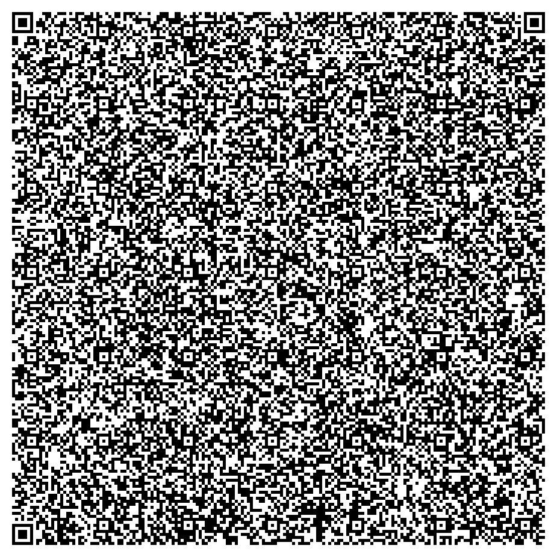

# Hop!

Platformówka w stylu klasycznych gier z 8-bitowych konsol, z jedną pełną planszą. Bohater i przeciwnicy są własnego projektu.

## Sterowanie
- **Telefon:** lewy dolny róg to bieg w lewo i w prawo, prawa połowa ekranu to skok
- **Komputer:** strzałki ← → i strzałka w górę lub spacja
- Im dłużej trzymasz skok, tym wyżej skaczesz. Ekran przewija się tylko do przodu.

## Na planszy
- **Złote skrzynki z czerwoną taśmą** — uderzenie głową od spodu daje 100 punktów
- **Cegły** — rozbijasz je głową (50 punktów)
- **Monety** — 100 punktów
- **Fioletowe gluty** — wskoczenie na nie daje 200 punktów, dotknięcie z boku oznacza śmierć
- **Przepaści**, słupki i schody, a na końcu **meta z czerwoną flagą**
- Po śmierci plansza zaczyna się od nowa

Najlepiej grać na ekranie poziomym.

## Pliki
| Plik | Opis |
|---|---|
| `gra.html` | Kod gry |
| `qr.png` | Kod QR z linkiem do ładowarki |
| `link.txt` | Ten sam link jako tekst |

## Rozmiar
- Kod: 4100 bajtów
- Link: 2949 znaków z 2953 — QR w wersji 40, praktycznie zero zapasu. Każda zmiana wymaga wycięcia czegoś innego.
