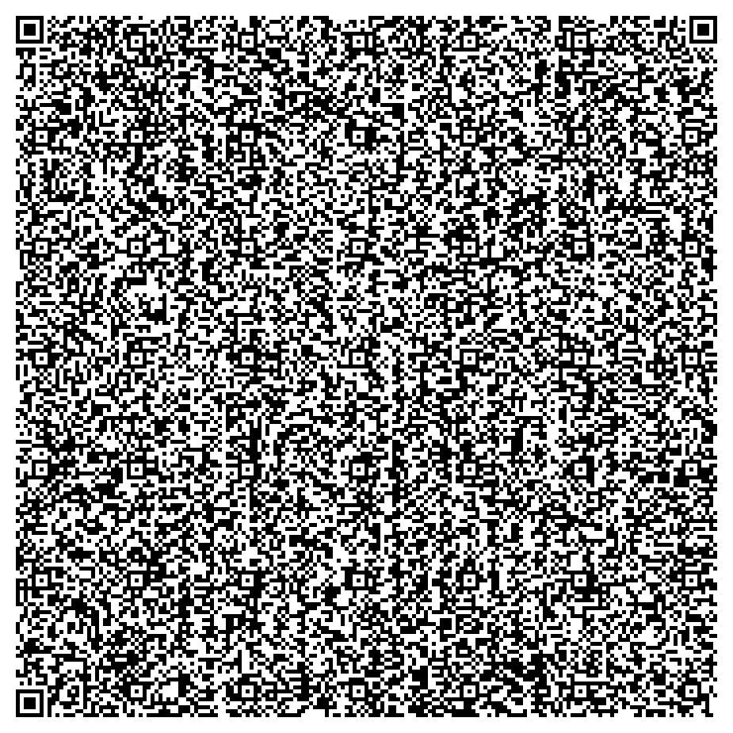

# Kurier ORLEN Paczka

Wyścigówka z widokiem z góry w kolorystyce ORLEN Paczka. Jedziesz busem kurierskim, zbierasz paczki z drogi i dowozisz je do automatów paczkowych APM.

## Sterowanie
- **Telefon:** stuknięcie w lewą lub prawą połowę ekranu zmienia pas
- **Komputer:** strzałki ← →, spacja startuje i restartuje

## Zasady
- **Paczki** (kartony) — zbierasz do busa, maksymalnie 5. Widać je na dachu.
- **APM** (czerwony automat z białymi skrytkami) — wjazd oddaje wszystkie paczki, każda to punkt.
- **Dystrybutor** (czerwono-biały) — tankuje do pełna. Paliwo stale ubywa, pusty bak kończy grę.
- **Auta** — każde zderzenie odbiera jedno z 3 żyć.
- Gra stopniowo przyspiesza. Rekord zapisuje się w przeglądarce.

## Pliki
| Plik | Opis |
|---|---|
| `gra.html` | Kod gry |
| `qr.png` | Kod QR z linkiem do ładowarki |
| `link.txt` | Ten sam link jako tekst |

## Rozmiar
- Kod: ok. 4,0 KB
- Link: 2848 znaków (QR w wersji 40)

Na ekranie startowym jest napis „ORLEN Paczka” (bez logotypu). Przed publicznym udostępnieniem warto to uzgodnić z działem marki.
