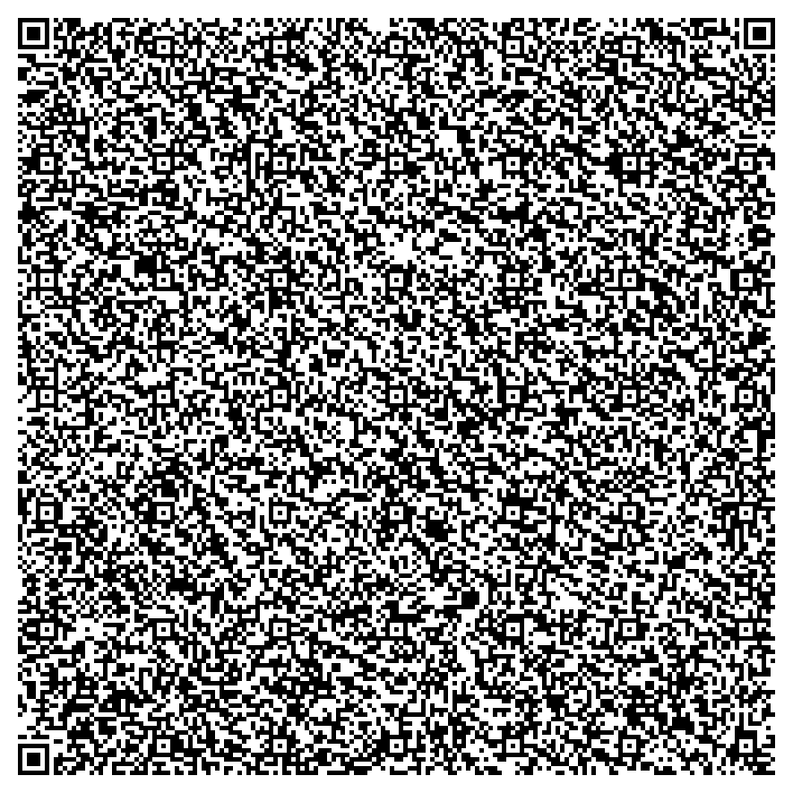

# Memory APM

Gra w pary wyglądająca jak automat paczkowy ORLEN Paczka. Otwierasz skrytki i szukasz par takich samych symboli.

## Sterowanie
- Stuknięcie lub kliknięcie skrytki ją otwiera
- Po wygranej stuknięcie w ekran automatu zaczyna nową grę

## Zasady
- 26 skrytek, czyli 13 par symboli (paczka, kurier, dom, paliwo, prezent, klucz itd.)
- Odnaleziona para zostaje otwarta z czerwoną obwódką, nietrafiona zamyka się po chwili
- Ekran automatu pokazuje ruchy, pary i czas
- Rekord to najmniejsza liczba ruchów, zapisywana w przeglądarce

## Wygląd
Wzorowany na zdjęciu prawdziwego automatu: jasnoszare skrytki, daszek z przeszkleniem, ciemny cokół, czerwony przekrzywiony kwadrat z napisem „ORLEN paczka” (odtworzony, nie oryginalna grafika) oraz czerwona i grafitowa ramka „nadrukowana” na drzwiczkach.

## Pliki
| Plik | Opis |
|---|---|
| `gra.html` | Kod gry |
| `qr.png` | Kod QR z linkiem do ładowarki |
| `link.txt` | Ten sam link jako tekst |

## Rozmiar
- Kod: ok. 4,0 KB
- Link: 2570 znaków (QR w wersji 38)
