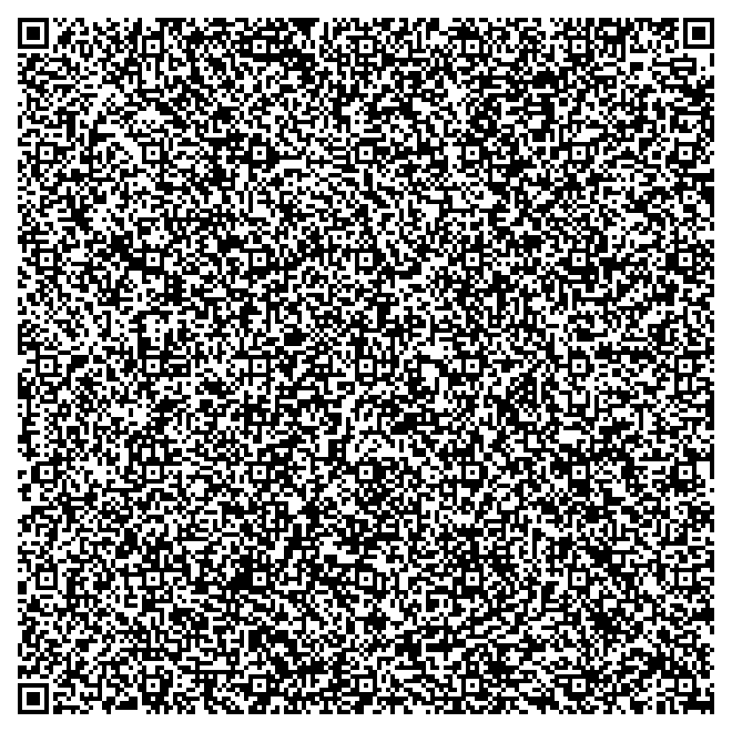

# Ptak

Zręcznościówka w stylu „flappy”: stukasz w ekran, żeby ptak podskoczył, i przelatujesz przez szczeliny między rurami.

## Sterowanie
- **Telefon:** stuknięcie w ekran
- **Komputer:** spacja, strzałka w górę albo kliknięcie

## Co jest w grze
- Gradientowe niebo, chmury i dwa pasma wzgórz z paralaksą
- Ptak pochyla się zależnie od prędkości i macha skrzydłem
- Gra przyspiesza, a przerwy między rurami się zwężają
- Dźwięki generowane w przeglądarce (Web Audio): skok, punkt (co 10. wyżej), zderzenie
- Biały błysk przy zderzeniu, napis „NOWY REKORD!”, rekord zapisywany w przeglądarce

## Pliki
| Plik | Opis |
|---|---|
| `gra.html` | Kod gry (wersja z linku) |
| `qr.png` | Kod QR z linkiem do ładowarki — skanujesz i grasz |
| `link.txt` | Ten sam link jako tekst |
| `gra-offline.html` | Starsza wersja bez zapisu rekordu, do wersji offline |
| `qr-offline.png` | Kod QR z adresem `data:text/html,…` — działa bez internetu, ale tekst trzeba skopiować i wkleić w pasek adresu przeglądarki |

## Rozmiar
- Kod: ok. 3,0 KB
- Link: 2266 znaków (QR w wersji 35)
- Wersja offline: 2904 bajty (QR w wersji 40)
