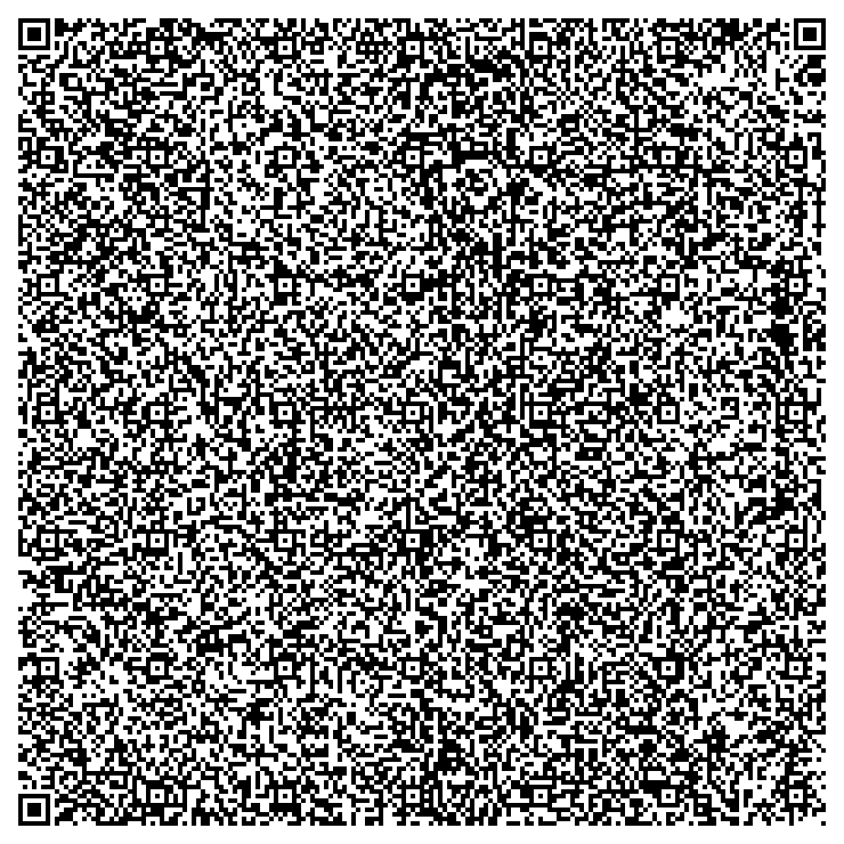

# QR Linux

Udawany terminal Linuksa mieszczący się w jednym kodzie QR. To nie jest prawdziwy system, tylko przekonująca imitacja: „bootuje się” z komunikatami jądra, loguje i daje powłokę z kilkunastoma poleceniami.

## Polecenia
| Polecenie | Co robi |
|---|---|
| `help` | Lista poleceń |
| `ls`, `ls -a` | Zawartość katalogu (z `-a` także ukryte pliki) |
| `cd`, `pwd` | Poruszanie się po systemie plików (`~`, `..`, ścieżki bezwzględne) |
| `cat` | Wyświetla plik |
| `echo` | Wypisuje tekst |
| `neofetch` | Pingwin i informacje o systemie |
| `uname`, `whoami`, `date`, `uptime` | Informacje o systemie |
| `gra` | Zgadywanie liczby od 1 do 100 |
| `sudo`, `rm` | Żarty (spróbuj `rm -rf /`) |
| `clear` | Czyści ekran |
| `reboot`, `exit` | Uruchamia system od nowa |

Działa też **historia poleceń** (strzałki ↑ ↓) i **dopełnianie Tabem** nazw poleceń i plików.

## System plików
`/bin`, `/etc` (`hostname`, `os-release`), `/home/user` (`readme.txt`, `notatki.txt` i ukryty plik do znalezienia), `/tmp`.

## Pliki
| Plik | Opis |
|---|---|
| `gra.html` | Kod terminala |
| `qr.png` | Kod QR z linkiem do ładowarki |
| `link.txt` | Ten sam link jako tekst |

## Rozmiar
- Kod: 3824 bajty
- Link: 2937 znaków z 2953 (QR w wersji 40)

## Dlaczego nie prawdziwy Linux?
Prawdziwy Linux w przeglądarce potrzebuje emulatora procesora i jądra z systemem plików — to megabajty. Na przykład LinuxPDF (Linux w pliku PDF) waży ok. 6 MB, czyli tyle co ok. 2000 kodów QR.
